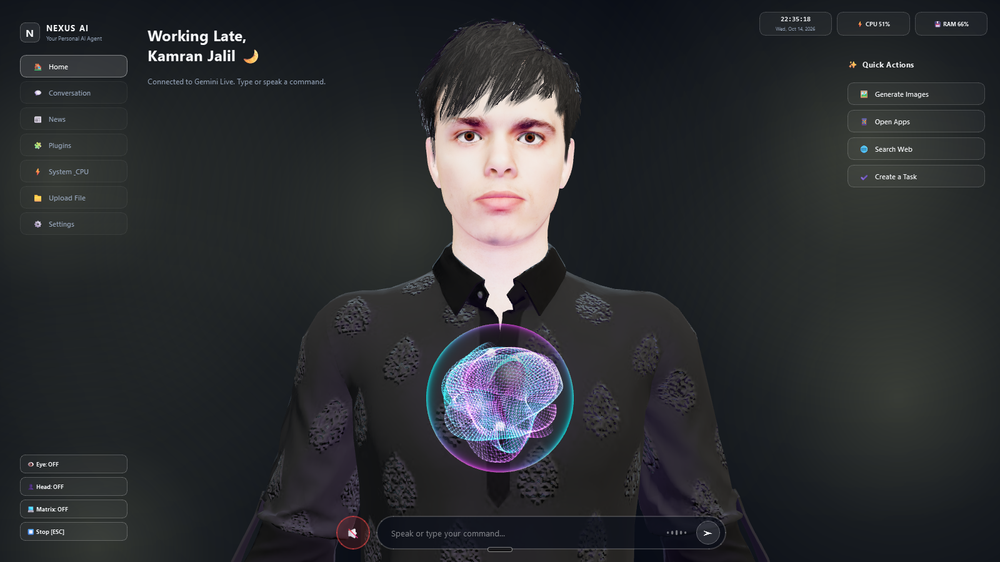

<div align="center">

# ⚡ NEXUS AI
### Autonomous Multimodal Desktop Agent & Holographic OS

[](https://www.python.org/)
[](https://deepmind.google/technologies/gemini/)
[](https://www.microsoft.com/windows)
[](https://github.com/Duckierpine3108/Nexus-AI/releases)
[](https://www.linkedin.com/in/kamranjalilkhan/)

<br />

> **NEXUS AI** is an advanced local desktop operating assistant powered by Google's native bi-directional **Gemini 2.5 Flash Audio API**, offline **Vosk Kaldi** neural wake engines, and a live reactive **3D holographic avatar**. It doesn't just answer questions—it operates your operating system, handles WhatsApp calls, writes and executes code, manipulates files, and automates multi-browser tasks in real time.

<br />

---

</div>

## 📸 The Interface

<div align="center">
  
  <p><i>Real-time 3D reactive avatar with audio-reactive quantum core, live system metrics, and initialization modal.</i></p>
</div>

---

## 🚀 Flagship Architectural Features

### 1. 🧬 Interactive 3D Avatar & Quantum Energy Core
* **Real-Time 3D Mesh Engine:** Renders an interactive 3D avatar head (`head.glb`) with dynamic camera tracking and continuous audio-reactive speech animation.
* **Quantum Core Visualizer:** A pulsing, multi-frequency holographic arc core that visually reflects AI thinking, listening, and audio energy states.
* **Custom Dark Stark-OS Interface:** Built with hardware-accelerated UI, live CPU/RAM telemetry, quick-action drawers, and dark mode aesthetics.

### 2. ⚡ Full-Duplex Real-Time Voice (Gemini 2.5 Flash Live)
* **True Bi-directional Audio:** Direct 16kHz audio streaming and 24kHz raw PCM speech synthesis with zero-latency interruption support.
* **DSP Analog Pre-Amp Booster:** Integrated digital signal processing applying a 3.5x gain multiplier and smooth `tanh` saturation curves to deliver crystal-clear, distortion-free sound.
* **Dual-State Offline Wake Word Engine:** Powered by an offline **Vosk Kaldi** model listening locally for *"Hey Nexus"* or *"Computer"*. Prevents unauthorized open-mic streaming and auto-mutes upon 1.2s of conversational silence.

### 3. 📞 WhatsApp Desktop Telephony & Message Agent
* **Autonomous Call Management:** Initiates voice and video calls (`whatsapp_call`), hangs up on voice command, and answers incoming rings.
* **Smart Call Decline with Auto-SMS:** Declines calls and immediately dispatches personalized explanations to the caller via chat.
* **Automated Incoming Ring Radar:** Background listener detects live desktop rings, maximizes master system volume, and alerts the user with urgency.
* **File & Live Screenshot Dispatch:** Automatically captures your screen or selects target disk files and delivers them directly into any contact's WhatsApp thread.

### 4. 💻 Autonomous Dev Agent & Multi-File Scaffold Engine
* **Self-Building Code Studio:** Plans, scaffolds, writes, and tests entire multi-file software projects from natural language instructions.
* **Automated Package Resolution:** Automatically detects missing Python libraries, installs them via pip, opens VS Code, and executes code while auto-patching runtime traceback errors.

### 5. 📂 Universal Multi-Format File Intelligence
* **Full-Spectrum Processing:** Handles images (OCR, resizing, compression), PDFs (summarization, extraction, DOCX conversion), Excel/CSV (data filtering, statistical analysis), and video/audio (trimming, frame extraction, transcription).
* **Deep OS File Controller:** Full disk operations including file creation, regex searches, disk usage audits, and automated Desktop organization into dated archives.

### 6. 🌐 Multi-Browser Web Automation & Control
* **Universal Browser Driver:** Controls Chrome, Edge, Firefox, Brave, and Opera GX simultaneously.
* **Smart Interaction:** Intelligently clicks elements, types into input fields, scrapes text, scrolls pages, and handles private/incognito workflows.

### 7. 🎨 FLUX.1 Cinematic Generative Studio
* **High-Resolution Wallpaper Engine:** Generates cinematic 16:9 photorealistic 8K wallpapers using state-of-the-art FLUX.1 models in parallel.
* **Gesture & Snap Gallery:** Automatically opens generated images and allows instant cycling through image variations using voice commands or finger snaps.

### 8. 🔒 Encrypted Web Dashboard & Remote Phone Relay
* **Local Network SSL Command Server:** Encrypted FastAPI/Uvicorn server secured by local SSL certificates (`jarvis.crt`).
* **Smartphone Audio Bridge:** Pair any smartphone via instant QR code auto-login to route mobile microphone audio directly into NEXUS AI from anywhere on the local network.

---

## 🛠️ System Architecture

```text
 ┌───────────────────────┐
 │ Microphone (Hardware) │
 └───────────┬───────────┘
             │ (Local Offline Gate)
 ┌───────────▼───────────────────────────────────────────────┐
 │ Vosk Kaldi Wake Engine ("Hey Nexus" / "Computer")        │
 └───────────┬───────────────────────────────────────────────┘
             │ (Unmuted)
 ┌───────────▼───────────────────────────────────────────────┐
 │ Google Gemini 2.5 Flash Native Audio Live Session        │
 └───────────┬───────────────────────────────────────────────┘
             │ (Function Call / Tool Invocation)
 ┌───────────▼───────────────────────────────────────────────┐
 │ NEXUS Action & Tool Dispatcher                            │
 ├──────────────┬──────────────┬──────────────┬──────────────┤
 │  WhatsApp    │   Browser    │  Dev Agent   │ Universal    │
 │  Automation  │  Playwright  │  Code Studio │ File Engine  │
 ├──────────────┼──────────────┼──────────────┼──────────────┤
 │  Desktop/OS  │    FLUX.1    │  Vision/Cam  │ Remote Web   │
 │  Management  │  Generation  │  Inspection  │ Dashboard    │
 └──────────────┴──────────────┴──────────────┴──────────────┘
             │
 ┌───────────▼───────────────────────────────────────────────┐
 │ 3D Holographic UI Engine & Dedicated DSP Audio Player     │
 └───────────────────────────────────────────────────────────┘
```

---

## 📦 Installation & Setup

### Method A: One-Click Windows Installer (Recommended)

1. Go to the [**NEXUS AI Releases Page**](https://github.com/Duckierpine3108/Nexus-AI/releases/latest).
2. Download **`nexus_ai_setup.exe`**.
3. Run the installer and follow the setup wizard.
4. Launch **NEXUS AI** from your desktop or start menu shortcut.
5. Enter your [Google Gemini API Key](https://aistudio.google.com/) on the initialization screen to begin.

### Method B: Run From Source (Developers)

```bash
# 1. Clone the repository
git clone https://github.com/Duckierpine3108/Nexus-AI.git
cd Nexus-AI

# 2. Create and activate a Python 3.11 virtual environment
python -m venv venv
venv\Scripts\activate

# 3. Install core dependencies
pip install -r requirements.txt

# 4. Launch the application
python main.py
```

---

## 🔒 Security & Privacy Policy

* **Zero-Secret Architecture:** The source code and installer contain **zero** hardcoded API keys or personal tokens.
* **Local Speech Processing:** Wake-word detection is processed 100% locally on your machine via Vosk Kaldi neural weights without sending any ambient audio to cloud servers.
* **Encrypted Remote Control:** Local network dashboard transmissions are encrypted end-to-end with TLS/SSL encryption certificates.

---

## 👨‍💻 Author

**Kamran Jalil**  
*AI Engineer & Software Architect*

* **LinkedIn:** [linkedin.com/in/kamranjalilkhan](https://www.linkedin.com/in/kamranjalilkhan/)
* **GitHub:** [@Duckierpine3108](https://github.com/Duckierpine3108)

---

<div align="center">
  <sub>Built with passion for next-generation multimodal artificial intelligence.</sub>
</div>